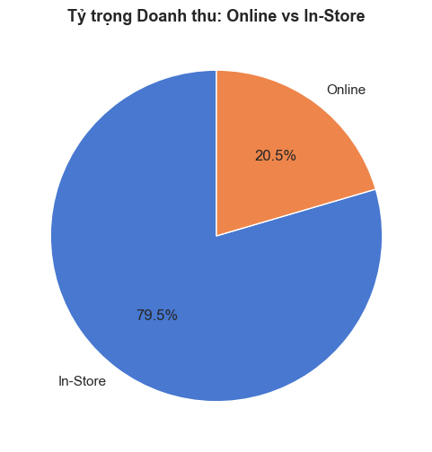
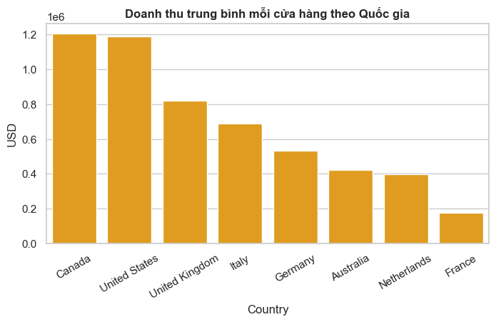
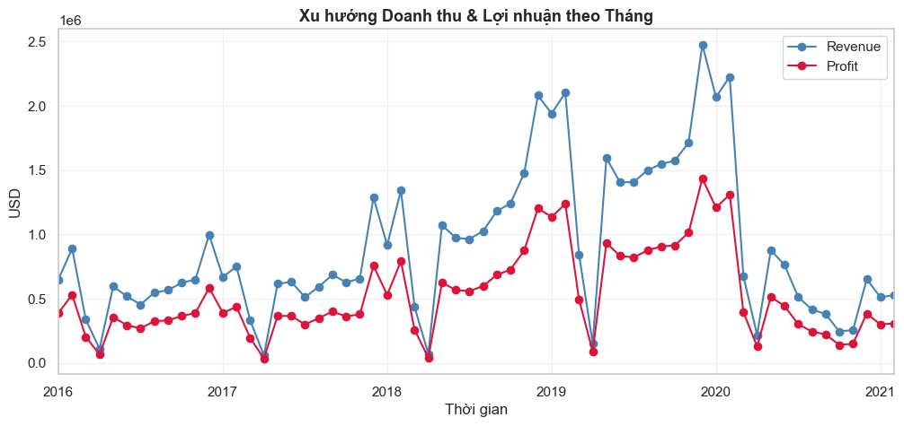
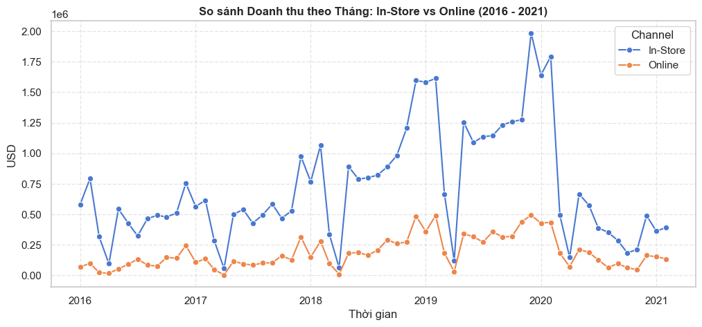
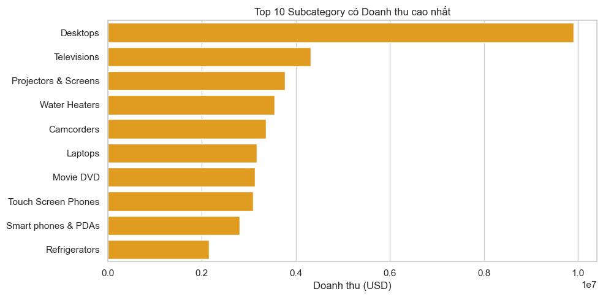
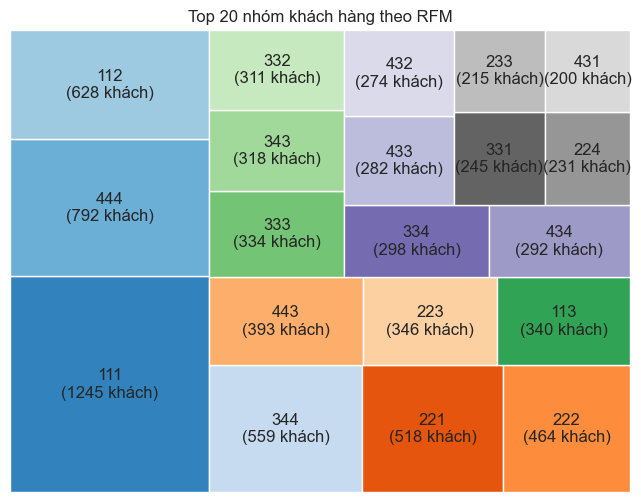

# GLOBAL ELECTRONIC RETAILER - SALES & CUSTOMER INTELLIGENCE
### Khảo sát hiệu quả chuỗi bán lẻ đa quốc gia và phân khúc khách hàng chuyên sâu (2016 - 2021)

[](scripts/Global_Electronic_Retailer_Processing.ipynb)
[](scripts/Global_Electronic_Retailer_Processing.ipynb)
[](data/data_dictionary.md)
[](reports/Global_Electronic_Retailer_Report.pdf)

> **Mục đích dự án:** Đánh giá sức khỏe tài chính toàn diện cho chuỗi bán lẻ thiết bị điện tử quy mô 55,76 triệu USD (67 điểm bán tại 8 quốc gia). Tối ưu hóa cơ cấu phân phối In-Store vs Online, giải quyết điểm nghẽn rủi ro sản phẩm và ứng dụng mô hình RFM kết hợp Ma trận BCG để nhận diện tệp khách hàng giá trị cao cùng nhóm có nguy cơ rời bỏ.

## 📑 Mục lục
1. [Cấu trúc thư mục Repository](#1-cấu-trúc-thư-mục-repository)
2. [Khai phá dữ liệu và Tiền xử lý kỹ thuật](#2-khai-phá-dữ-liệu-và-tiền-xử-lý-kỹ-thuật)
3. [Tổng quan kết quả kinh doanh và Kênh phân phối](#3-tổng-quan-kết-quả-kinh-doanh-và-kênh-phân-phối)
4. [Phân tích hiệu quả mạng lưới địa lý](#4-phân-tích-hiệu-quả-mạng-lưới-địa-lý)
5. [Chuỗi thời gian, Hành vi mùa vụ và Cú sốc Covid-19](#5-chuỗi-thời-gian-hành-vi-mùa-vụ-và-cú-sốc-covid-19)
6. [Cơ cấu sản phẩm và Rủi ro tập trung danh mục](#6-cơ-cấu-sản-phẩm-và-rủi-ro-tập-trung-danh-mục)
7. [Mô hình phân khúc khách hàng RFM và Ma trận BCG](#7-mô-hình-phân-khúc-khách-hàng-rfm-và-ma-trận-bcg)
8. [Đề xuất chiến lược kinh doanh thực tế](#8-đề-xuất-chiến-lược-kinh-doanh-thực-tế)

---

## 1. Cấu trúc thư mục Repository

```text
Global-Electronic-Retailer-Analysis/
├── .gitignore                          # Chặn file tạm, checkpoint, OS junk và ẩn thư mục data/raw/
├── README.md                           # Báo cáo tổng quan điều hành dự án
├── data/
│   ├── data_dictionary.md              # Từ điển dữ liệu chi tiết và quan hệ bảng Star Schema
│   └── sample/                         # Dữ liệu trích xuất 1.000 dòng mẫu/bảng phục vụ kiểm thử
│       ├── Customers_sample.csv
│       ├── Exchange_Rates_sample.csv
│       ├── Products_sample.csv
│       ├── Sales_sample.csv
│       └── Stores_sample.csv
├── scripts/
│   └── Global_Electronic_Retailer_Processing.ipynb # 100% mã nguồn gốc xử lý ETL, EDA, CRR và RFM
├── reports/
│   └── Global Electronic Retailer Report.pdf      # Slide báo cáo điều hành 13 trang hoàn chỉnh
└── docs/
    └── images/                         # 6 biểu đồ trực quan trích xuất trực tiếp từ mã nguồn
        ├── 01_channel_revenue_share.png
        ├── 02_store_productivity_country.png
        ├── 03_monthly_revenue_profit_trend.png
        ├── 04_covid19_channel_divergence.png
        ├── 05_top10_subcategory_revenue.png
        └── 06_rfm_bcg_treemap.png
```
*(Ghi chú: Toàn bộ dữ liệu gốc tại `data/raw/` được cấu hình ẩn trong `.gitignore` để bảo mật dữ liệu).*

---

## 2. Khai phá dữ liệu và Tiền xử lý kỹ thuật

Hệ thống dữ liệu tổ chức theo chuẩn Star Schema gồm Fact `Sales` (62.884 dòng) liên kết 4 bảng Dimension: `Customers` (15.266 khách, có 11.887 khách phát sinh đơn), `Products` (2.517 sản phẩm), `Stores` (67 điểm bán: StoreKey = 0 là Online, 1-66 là Showroom) và `Exchange_Rates` (11.215 dòng quy đổi tỷ giá sang USD).

**Xử lý chất lượng dữ liệu (Data Quality):**
* *Làm sạch tiền tệ:* Cột `Unit Cost USD` và `Unit Price USD` chứa ký tự `$` và dấu phẩy `,` dạng chuỗi được bóc tách và chuyển sang kiểu `float64`.
* *Xử lý giá trị thiếu:* Cột `Delivery Date` thiếu 49.719 dòng (~79%) do khách mua tại Showroom nhận hàng trực tiếp; chỉ đơn Online mới có ngày giao vận. Giữ nguyên toàn bộ dòng và chỉ tính `Delivery Days` cho đơn có giá trị.
* *Chuẩn hóa thời gian:* Ép kiểu `Order Date` và `Delivery Date` sang định dạng chuẩn `datetime64[ns]`.

**Feature Engineering:**
* Phân loại kênh: `Channel = IF StoreKey == 0 THEN 'Online' ELSE 'In-Store'`.
* Chỉ số tài chính: `Revenue = Quantity * Unit Price`, `Cost = Quantity * Unit Cost`, `Profit = Revenue - Cost`, `Margin (%) = Profit / Revenue`.
* *Chuẩn hóa Contract Age chống thiên vị:* Khách mới gia nhập nếu chia cho số ngày hợp đồng nhỏ sẽ bị phóng đại giá trị F và M. Xử lý bằng kỹ thuật `contract_age.clip(lower=1.0)`: Ép mốc sàn tối thiểu 1.0 năm để giữ nguyên giá trị thực tế của khách hàng mới, đảm bảo tính khách quan cho mô hình RFM.

---

## 3. Tổng quan kết quả kinh doanh và Kênh phân phối

Chuỗi bán lẻ đạt doanh thu lũy kế 55,76 triệu USD với biên lợi nhuận gộp đạt 58,58%. Kênh In-Store chiếm gần 80% doanh thu nhưng kênh Online có tiềm năng mở rộng lớn với hiệu quả sinh lời tương đương:

| Kênh phân phối | Số điểm bán | Doanh thu (USD) | Tỷ trọng | Giá vốn (USD) | Lợi nhuận (USD) | Biên lợi nhuận |
|---|:---:|:---:|:---:|:---:|:---:|:---:|
| **In-Store (Offline)** | 66 showroom | 44.351.154,96 | 79,54% | 18.361.159,22 | 25.989.995,74 | 58,60% |
| **Online (Website)** | 1 nền tảng | 11.404.324,63 | 20,46% | 4.731.631,99 | 6.672.692,64 | 58,51% |
| **Toàn hệ thống** | **67** | **55.755.479,59** | **100,00%** | **23.092.791,21** | **32.662.688,38** | **58,58%** |



> **Key Insight:** Biên lợi nhuận gộp kênh Online (58,51%) tương đương kênh Offline (58,60%). Điều này chứng minh việc dịch chuyển ngân sách sang tiếp thị số và thương mại điện tử không làm xói mòn tỷ suất sinh lời của doanh nghiệp.

---

## 4. Phân tích hiệu quả mạng lưới địa lý

Đánh giá hiệu quả kinh doanh trên 8 quốc gia làm rõ sự phân hóa sâu sắc về năng suất cửa hàng:

| Quốc gia | Số showroom | Doanh thu (USD) | Doanh thu TB/Cửa hàng (USD) | Giá trị TB/Đơn hàng (USD) | Đánh giá hiệu quả |
|---|:---:|:---:|:---:|:---:|---|
| **Canada** | 3 | 3.611.561,79 | **1.203.853,93** | **589,67** | **Dẫn đầu toàn cầu** - Sức mua cực mạnh |
| **United States** | 20 | 23.764.425,86 | 1.188.221,29 | 557,65 | Thị trường chủ lực, hiệu suất vững chắc |
| **United Kingdom** | 7 | 5.749.769,78 | 821.395,68 | 397,71 | Hiệu quả khá |
| **Italy** | 3 | 2.059.086,81 | 686.362,27 | 296,67 | Hiệu quả trung bình khá |
| **Germany** | 8 | 4.246.279,22 | 530.784,90 | 237,75 | Năng suất trung bình |
| **Australia** | 5 | 2.099.141,07 | 419.828,21 | 180,20 | Quy mô giỏ hàng thấp |
| **Netherlands** | 4 | 1.591.344,48 | 397.836,12 | 194,00 | Quy mô giỏ hàng thấp |
| **France** | 7 | 1.229.545,95 | **175.649,42** | **81,57** | **Kém nhất toàn cầu** - Vận hành dưới điểm hòa vốn |



> **Key Insight:** Canada chỉ có 3 showroom nhưng đạt doanh thu bình quân 1,20 triệu USD/cửa hàng và quy mô đơn hàng 589,67 USD (vượt cả thị trường Mỹ). Ngược lại, Pháp mở tới 7 showroom nhưng doanh thu bình quân chỉ đạt 175.649 USD/cửa hàng (kém 6,8 lần Canada).

---

## 5. Chuỗi thời gian, Hành vi mùa vụ và Cú sốc Covid-19

Phân tích xu hướng kinh doanh (2016-2021) làm rõ tính chu kỳ mua sắm và rủi ro gián đoạn vận hành:




* **Hành vi mùa vụ:** Tháng 1-2 đạt đỉnh mua sắm thiết bị mới; tháng 3-4 là vùng trũng nhu cầu; tháng 11-12 là thời điểm vàng săn khuyến mãi Black Friday và Giáng Sinh.
* **Cú sốc Covid-19 (Tháng 03/2020):** Lệnh phong tỏa làm kênh In-Store đóng băng, doanh thu sụt giảm đột ngột; Online chưa kích hoạt hiệu quả để bù đắp, dẫn đến tỷ lệ giữ chân khách hàng (CRR) sụt giảm mạnh:

| Giai đoạn so sánh | Khách đầu kỳ (S) | Khách cuối kỳ (E) | Khách mới (N) | Khách cũ quay lại (E - N) | Tỷ lệ giữ chân (CRR) |
|---|:---:|:---:|:---:|:---:|:---:|
| 2016 - 2017 | 2.561 | 2.907 | 2.376 | 531 | 20,73% |
| 2017 - 2018 | 2.907 | 4.765 | 3.104 | 1.661 | 57,14% |
| 2018 - 2019 | 4.765 | 6.497 | 2.832 | 3.665 | **76,92% (Đỉnh tăng trưởng)** |
| 2019 - 2020 | 6.497 | 3.868 | 947 | 2.921 | **44,96% (Lao dốc do dịch)** |

> **Key Insight:** Năm 2020, lượng khách mới giảm 66,56% (từ 2.832 xuống 947). Doanh nghiệp vẫn giữ được 2.921 khách trung thành cũ, nhưng việc gián đoạn showroom vật lý kéo CRR rơi từ 76,92% xuống 44,96%.

---

## 6. Cơ cấu sản phẩm và Rủi ro tập trung danh mục

Danh mục gồm 8 nhóm ngành hàng chính và 32 tiểu ngạch có sự phân hóa vai trò dòng tiền rõ rệt:



| Phân khúc vai trò | Subcategory tiêu biểu | Lượng đơn hàng | Doanh thu tích lũy | Tỷ trọng và Phân tích vai trò |
|---|---|:---:|:---:|---|
| **Trụ cột doanh thu** | Desktops | 5.823 đơn | ~9,8 triệu USD | Chiếm 51% ngành Computers và 18% tổng doanh thu toàn chuỗi |
| **Trụ cột bổ trợ** | Televisions, Projectors, Water Heaters | 1.500 - 3.200 đơn | ~2,5 - 3,5 triệu USD | Giỏ hàng giá trị cao, biên lợi nhuận ổn định |
| **Sản phẩm mồi** | Movie DVD, Games (Download & Boxed) | 14.350 đơn | <1,5 triệu USD | Movie DVD (7.788 đơn), Games (6.562 đơn); kéo traffic nhưng chưa bán kèm |

> **Key Insight:** Doanh nghiệp đang phụ thuộc lớn vào dòng Desktops và lãng phí lượng traffic mua sắm khổng lồ từ Movie DVD và Games do chỉ bán lẻ đơn giá thấp mà chưa có gói combo bán chéo với phụ kiện âm thanh hay máy tính có biên lãi cao.

---

## 7. Mô hình phân khúc khách hàng RFM và Ma trận BCG

Chỉ số R, F, M được tính toán mốc ngày 20/02/2021 và xếp hạng từ 1 đến 4 theo các **mốc phân vị 25%, 50%, 75%**: `Recency` (mua gần nhất), `Frequency` (tần suất/năm), `Monetary` (chi tiêu/năm).



Ma trận BCG định vị chi tiết 11.887 khách hàng phát sinh đơn thành 4 phân khúc chiến lược rõ ràng (không viết gộp):

| Phân khúc BCG | Kiểu khách hàng | Tiêu chí R-F-M | Số khách | Tỷ lệ | Danh sách toàn bộ mã RFM cấu thành | Đặc điểm hành vi và Định hướng xử lý |
|---|---|:---:|:---:|:---:|---|---|
| **Star** | VIP hoàn hảo | R in [3,4]<br>F in [3,4]<br>M in [3,4] | 3.268 | 27,49% | 333, 444, 433, 443, 434, 343, 334, 344 (8 mã) | Giao dịch gần, tần suất dày đặc, chi tiêu lớn nhất; mang lại dòng tiền cốt lõi cần chăm sóc đặc quyền |
| **Question Mark** | Tiềm năng và Cựu VIP | M in [3,4]<br>(chưa thành Star) | 2.676 | 22,51% | 223, 123, 124, 114, 113, 214, 233, 324, 224, 213, 243, 133, 234, 323, 244, 424, 423, 313, 134, 413, 414, 144, 314, 143 (24 mã) | Chi tiêu lớn nhưng tần suất thưa hoặc đã lâu chưa mua lại; gồm cả cựu VIP rời bỏ cần kích hoạt khẩn cấp |
| **Cash Cow** | Trung thành ổn định | F in [3,4]<br>M in [1,2] | 1.871 | 15,74% | 332, 331, 432, 431, 142, 231, 442, 342, 132, 341, 232, 441, 242, 131, 241, 141 (16 mã) | Mua đều đặn tạo dòng tiền mặt ổn định nhưng giỏ hàng nhỏ; cần giải pháp cross-sell nâng giá trị đơn |
| **Dog** | Vãng lai và Rời bỏ | Các tổ hợp còn lại | 4.072 | 34,26% | 321, 111, 112, 221, 421, 211, 222, 422, 212, 122, 322, 311, 121, 312, 412, 411 (16 mã) | Mua ít, chi tiêu thấp hoặc đã rời bỏ; tiếp cận bằng kênh tự động chi phí thấp |

> **Key Insight:** Điểm nghẽn lớn nhất nằm ở khâu kích hoạt ban đầu: Có tới 1.873 khách hàng (chiếm 15,8% tập khách) rơi vào mã 111 (1.245 khách) và 112 (628 khách) chỉ mua 1 lần rồi biến mất. Khâu chăm sóc khách hàng mới (Onboarding) đang thiếu hụt quy trình kích thích tái mua hàng.

---

## 8. Đề xuất chiến lược kinh doanh thực tế

| Trụ cột chiến lược | Vấn đề cốt lõi | Hành động triển khai cụ thể | Mục tiêu đo lường |
|---|---|---|---|
| **Kích hoạt Omnichannel** | Kênh In-Store chiếm 79,5% tạo rủi ro đứt gãy | Triển khai mã QR tại 66 showroom đưa khách lên Website và App Loyalty độc quyền; tung chiến dịch kích cầu tháng 3-4 xử lý vùng trũng doanh thu | Tăng tỷ trọng Online lên 35% trong 18 tháng |
| **Nuôi dưỡng Question Mark** | 2.676 khách chi tiêu cao nhưng tần suất thấp | Gửi chuỗi Email/SMS tự động sau mua từ 14-30 ngày (tặng voucher, gợi ý sản phẩm); cấp quyền Early Access để kích cầu mua lần 2, chặn đà rơi CRR | Chuyển đổi 25% Question Mark thành Star |
| **Tái phân bổ mạng lưới** | Canada quá tải (1,20M USD/cửa hàng), Pháp kém hiệu quả | Cấp vốn mở thêm 2-4 showroom tại thị trường Canada; đánh giá đóng cửa điểm bán dưới điểm hòa vốn tại Pháp, chuyển khách sang kênh số | Tối ưu 15% chi phí mặt bằng tại Pháp |
| **Đóng gói bán chéo (Bundle)** | Phụ thuộc Desktops (18% doanh thu), lãng phí mồi Movie/Games | Dùng Movie DVD (7.788 đơn) và Games (6.562 đơn) làm sản phẩm mồi đóng combo bán kèm thiết bị Audio, Headphones và phụ kiện; phát triển dòng Laptops mỏng nhẹ | Tăng giá trị giỏ hàng (AOV) thêm 20% |
